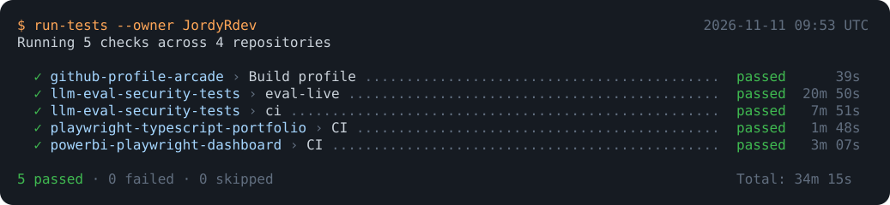

<!-- arcade:template-docs -->
# 🕹️ GitHub Profile Arcade

**A GitHub profile that builds itself.** Fill in one file, add a photo if you like, and every day a GitHub Action redraws your profile with your live stats:

- **A typing header** that cycles through your taglines
- **A neofetch-style card** with an ASCII portrait made from your photo, plus repos, stars, commits, followers and lines of code
- **Link buttons** that match the card
- **A CI test panel** that shows the latest workflow result of each of your public repos, like a Playwright run
- **Contribution Grand Prix**: an arcade racer that drives through your contribution graph and collects every day you contributed. It's a neon city at night in dark mode and a tropical coast in light mode

Everything is plain SVG, so it works in a GitHub README with no external services, no tokens to manage and nothing to host. It switches with the viewer's dark or light theme.

> **Live demo:** the profile below is built from this repo's own `profile.yml` by the same workflow you'll get.

<!-- arcade:header:start -->
<picture><source media="(prefers-color-scheme: dark)" srcset="assets/typing-dark.svg"><source media="(prefers-color-scheme: light)" srcset="assets/typing-light.svg"></picture>

<a href="https://github.com/JordyRdev"><picture><source media="(prefers-color-scheme: dark)" srcset="assets/card-dark.svg"><source media="(prefers-color-scheme: light)" srcset="assets/card-light.svg"></picture></a>

<p>
  <a href="https://github.com/JordyRdev?tab=repositories"><picture><source media="(prefers-color-scheme: dark)" srcset="assets/btn-0-dark.svg"><source media="(prefers-color-scheme: light)" srcset="assets/btn-0-light.svg"></picture></a>
  <a href="https://www.linkedin.com/in/jordyr86/"><picture><source media="(prefers-color-scheme: dark)" srcset="assets/btn-1-dark.svg"><source media="(prefers-color-scheme: light)" srcset="assets/btn-1-light.svg"></picture></a>
  <a href="mailto:jordydev@proton.me"><picture><source media="(prefers-color-scheme: dark)" srcset="assets/btn-2-dark.svg"><source media="(prefers-color-scheme: light)" srcset="assets/btn-2-light.svg"></picture></a>
</p>

<a href="https://github.com/JordyRdev?tab=repositories"><picture><source media="(prefers-color-scheme: dark)" srcset="assets/tests-dark.svg"><source media="(prefers-color-scheme: light)" srcset="assets/tests-light.svg"></picture></a>
<!-- arcade:header:end -->

<!-- arcade:race:start -->
### 🏁 Contribution Grand Prix

<picture><source media="(prefers-color-scheme: dark)" srcset="assets/race-dark.svg"><source media="(prefers-color-scheme: light)" srcset="assets/race-light.svg"></picture>
<!-- arcade:race:end -->

---

## Get your own in 5 minutes

1. **Click _Use this template → Create a new repository_** at the top of this page.
   Name the repository **exactly like your GitHub username** (for example `octocat/octocat`), and make it **public**. That's the special repo GitHub shows on your profile.
2. **Allow the workflow to write:** in your new repo, open *Settings → Actions → General → Workflow permissions*, choose **Read and write permissions**, and save.
3. **Edit `profile.yml`** in the browser (click the file, then the ✏️ pencil): your taglines, card lines, buttons and the plate on your car. Commit.
4. **Optional, your portrait:** upload a photo (*Add file → Upload files*), for example `assets/photo.jpg`, and set `portrait.photo: assets/photo.jpg` in `profile.yml`. A tightly cropped headshot works best.
5. Committing starts the build. After about a minute, open your profile. On the first run the build replaces this README with your own profile README (`README.profile.md`).

From then on it rebuilds every day. To rebuild right away, go to *Actions → Build profile → Run workflow*.

## Make it yours

| What | Where |
|---|---|
| Card lines, sections, uptime | `card:` in `profile.yml` (`{uptime}` = time since `uptime_since`) |
| Typing header | `header.taglines` |
| Buttons (1–4) | `buttons:` with `label`, `url`, and an `icon`: folder, briefcase, mail, globe, file, pen, chat or code |
| Portrait | `portrait:`: `photo`, `remove_background`, `invert` |
| Race | `race.plate` (your number plate) and `race.signs` (the neon signs at night) |
| Turn parts off | `show:` → `header`, `card`, `buttons`, `tests`, `race` |
| Your own README text | anything outside the `<!-- arcade:... -->` blocks in `README.md` is never touched |
| Private repos in your stats | add a `PROFILE_TOKEN` secret (classic token with `repo` and `read:user`) |

Want to go further? It's all small, readable Python in `scripts/`:

- `build.py`: the stats, card, header, buttons and test panel
- `race.py`: the race
- `portrait.py`: the photo-to-ASCII conversion

## How it works

- **Stats** come from the GitHub GraphQL and REST APIs with the workflow's built-in token: repos, stars, commits on default branches, lines added and deleted, the contribution calendar, and the latest Actions run per repo.
- **The card and the race** are generated SVGs. The race is pseudo-3D: the road, palms and signs are drawn once and scaled toward a vanishing point with SMIL animations. Every day you contributed becomes a block on the road, and quiet months fast-forward as roadside billboards.
- **The portrait** removes the background (rembg), boosts local contrast, and maps brightness to characters. It only rebuilds when your photo changes.

## Run it locally

```bash
pip install -r requirements.txt
python scripts/build.py                      # render with cached stats
GH_TOKEN=$(gh auth token) python scripts/build.py --fetch   # with fresh stats
```

## Credits

Built by [JordyRdev](https://github.com/JordyRdev). MIT licensed: fork it, remix it, make it yours.
